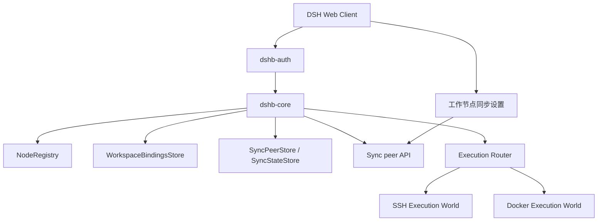

# 系统架构

## 概述

DSH-HoneyBee（DSHB）是运行在 DSH Cordis profile 中的插件，为 DSH Web 应用提供认证、工作节点管理、远程执行路由和工作区绑定能力。节点注册表、工作区镜像路径和会话仍由各 DSHB 实例本地管理。

工作节点同步按独立的跨实例功能实现。当前具备 peer 管理、SSH host-key 显式信任、有界传输协议、节点与可选会话同步、HLC 裁决、分支归档恢复、手动运行及每 peer 五分钟调度。设置页也提供口令加密的 `.dshb-sync` 离线配置迁移。

## 技术栈

- TypeScript、Node.js `>=22.13`、ESM。
- DSH Cordis 插件与 WebServer 路由。
- pnpm workspace、tsdown 构建、Vitest 测试。
- 状态元数据采用 `$DSH_HOME/dshb/` 下的 JSON 文件；节点秘密由上游 DSH credentials 服务管理。

## 项目结构

```text
packages/dshb/src/
├── auth/       # Web 登录、会话和路由保护
├── client/     # 工作节点设置和工作区选择界面
├── core/       # 节点注册表、HTTP 路由、工作区绑定与同步基础
├── exec-ssh/   # SSH 执行世界
├── exec-docker/# Docker 执行世界
├── router/     # 按工作区镜像路径选择执行世界
└── ui/         # DSH client 侧 UI 扩展

packages/dshb/test/ # Vitest 测试
.monkeycode/specs/  # 需求、设计和实施计划
```

## 子系统

### Core

**职责**：节点档案、凭据引用、工作区绑定、健康状态与管理 API。
**位置**：`packages/dshb/src/core/`

### Execution Router

**职责**：根据工作区镜像根将文件、shell、subprocess 和终端操作路由到相应节点。
**位置**：`packages/dshb/src/router/`、`packages/dshb/src/exec-ssh/`、`packages/dshb/src/exec-docker/`

### Sync Foundation

**职责**：peer 管理 API 和设置表单，隔离 SSH 秘密到 DSH credentials，校验 SSH host key，提供 loopback handshake、节点与会话 manifest、工作区映射、冲突归档恢复、HLC 协调、定时调度、运行进度、有界传输帧及口令加密离线归档。
**位置**：`packages/dshb/src/core/sync/`
**接入点**：`dshb-core` 提供 `syncPeerStore`、`syncStateStore`、`syncNodeService`、`syncSessionService`、`syncOfflineArchiveService`、`syncPeerManager`、`syncCoordinator` 和 `syncScheduler` 服务，并注册 peer、会话归档、内部传输和离线包路由。

## 组件关系



## 同步状态布局

- `$DSH_HOME/dshb/instance-id`：惰性生成的稳定实例身份。
- `$DSH_HOME/dshb/sync-peers.json`：peer 连接元数据，不接受密码、私钥或 passphrase 字段。
- `$DSH_HOME/dshb/sync-state.json`：HLC 时钟、peer 水位和来源记录元数据。
- `$DSH_HOME/dshb/sync-session-journal.json`：会话批次恢复索引；bundle 与 prepared session 暂存于 `sync-session-staging/`。
- `$DSH_HOME/dshb/sync-offline-journal.json`：离线导入节点/会话阶段状态；已认证 ZIP 留在关联 offline staging 目录直至两阶段完成。
- `$DSH_HOME/dshb/sync-offline-staging-*`：离线导入的加密文件和已认证解密 ZIP 暂存目录，操作结束后清理。
- JSON 文件以临时文件写入后原子重命名，文件权限为 `0600`；损坏的身份或状态会显式报错，避免自动重建导致来源身份漂移。

## 离线归档

`.dshb-sync` 使用 ZIP payload 和 AES-256-GCM 加密。固定 scrypt 参数（`N=32768, r=8, p=1`）派生 256 位密钥；随机 salt 与 nonce、格式版本和 KDF 参数组成认证数据，认证 tag 随密文附加。包内 manifest 列出来源实例、记录 origin/revision/tombstone、payload 摘要、会话选项和 DSH session 格式版本。

导入先流式保存密文并解密到受限权限 staging 文件，再验证 GCM tag、ZIP 路径/条目大小/CRC、manifest 摘要、节点和会话引用、目标 revision 冲突及保守磁盘空间预估。所有校验完成后才调用节点与会话同步 apply 服务。离线 journal 分别记录节点和会话阶段，进程中断后可从未完成阶段恢复；启动时清理上次进程遗留的离线 staging 与未登记的会话 staging。密码仅保存在当前导入上传令牌的内存中，令牌五分钟过期且单次使用；包文件不包含 SSH peer 凭据或 DSHB Web 登录凭据。
