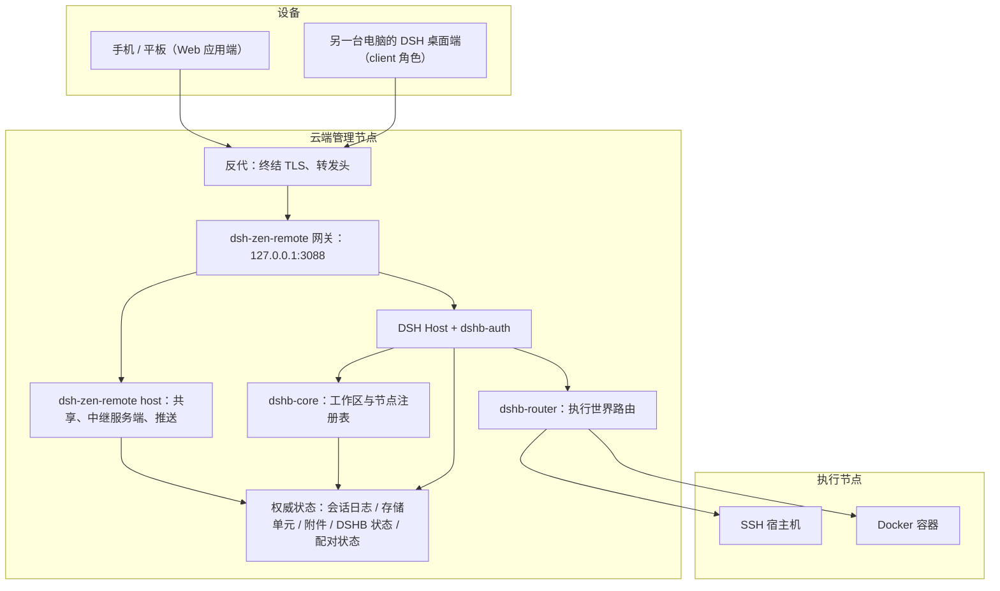
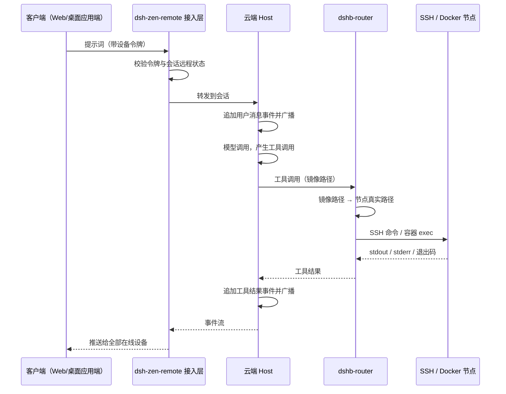
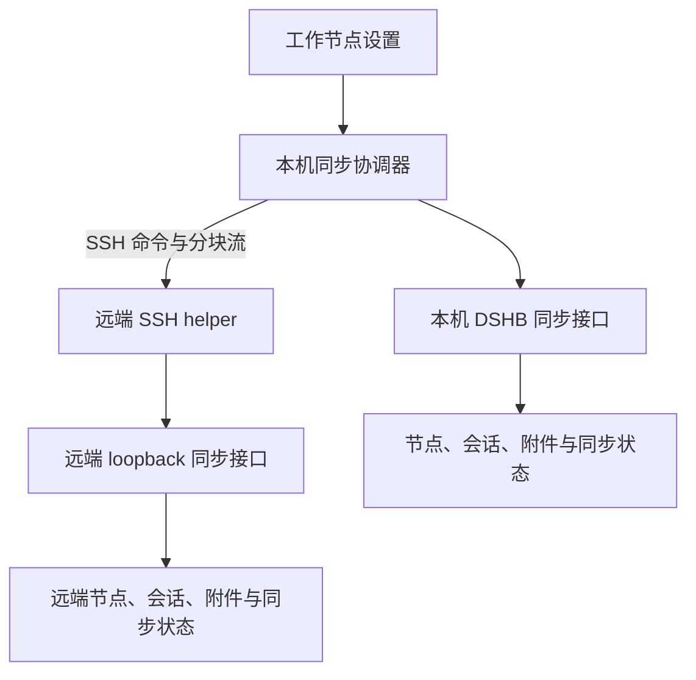

# 技术设计：DSHB 云端访问与跨实例同步

Feature Name: 2026-10-21-cloud-sync
Updated: 2026-10-25

## Description

云端访问仍由一台管理节点运行 DSH、DSHB 和 `dsh-zen-remote`（host 角色），手机与桌面应用通过现有接入层访问会话。新增跨实例同步后，一个 DSHB 安装可配置多个 SSH 同步节点，按所选方向与时机交换非默认工作节点配置及可选会话。

多设备远程接入层完整复用社区插件 `dsh-zen-remote`（KyoMio 维护，2.2.5，MIT）。实例间数据同步使用独立 SSH 通道和 DSHB 同步接口；首版只支持 SSH 账号认证，不以 DSHB 网页登录作为同步认证。

## 核心结论

1. **远程接入问题已有现成解。** `dsh-zen-remote` 的 host 角色恰好是「一台机器常开、跑会话，其余设备远程查看与接着干」，执行位置始终在 host；把它部署到云端管理节点，桌面端装 client 角色、手机走 Web 应用端，即满足单人多设备需求。其 peerDependencies `^0.2.1-alpha.1` 覆盖本项目的 DSH 0.2.1-rc.2。
2. **客户端访问与实例同步是两条路径。** `dsh-zen-remote` 继续提供设备接入和单一管理节点内的会话广播；多个 DSHB 实例之间通过 SSH 同步清单、节点档案和可选会话，来源身份用于去重和方向控制。
3. **桌面应用端的本地 Host 与远程接入不冲突。** 官方 DSH 桌面端仍启动本地 Host 承载本地工作区；`dsh-zen-remote` client 在其侧边栏追加「服务端名 · 工作区名」分组，本地会话完全不受影响。这是上游设计，无需改动桌面端。
4. **会话仍是单写者、多读者。** 持久化 seam 在 `create` 与 `open(id, 'write')` 时取得进程内所有权，第二次写打开以 `SessionAlreadyOwnedError` 拒绝（`node_modules/@deepseek-ai/dsh-session-persistence/README.zh.md:53`）。多设备并发因此收敛为「云端单一写入者 + 多客户端订阅」。
5. **会话导入需重映射工作目录。** 会话仍以各实例的持久化日志为本地权威；启用会话同步时，目标端导入远程工作区会话、依赖对象和指令快照，并将 header `cwd` 映射到目标实例为同一远程路径建立的镜像路径。
6. **双向冲突以最新版本胜出。** 节点配置采用逐记录的最新修改优先；会话事件日志是追加式分支，不能逐事件拼接。被裁决淘汰的会话分支用新本地 SessionId 保存为归档版本，活动版本继续使用新的完整日志。

## Architecture



接入层与执行层职责分明：`dsh-zen-remote` 只管「谁能看到哪些会话、令牌、推送」，DSHB 只管「会话在哪个执行节点干活、路径怎么翻译、凭据怎么存」。

## 组件与职责

| 组件 | 来源 | 职责 | 需改动 |
|---|---|---|---|
| 反代 | 部署方 | 终结 TLS、设 X-Forwarded-* 头、WebSocket 升级、大请求体 | 新增部署配置 |
| dsh-zen-remote 网关 | 社区插件 | 监听 127.0.0.1:3088、配对码、设备令牌、本机管理面独占 | 无 |
| dsh-zen-remote host | 社区插件 | 会话远程开关、中继服务端、按方法清单复核会话归属、Web Push | 无 |
| dshb-auth | DSHB | 登录、Cookie、鉴权门 | 无（保留单账号） |
| DSH Host | 上游 | 会话生命周期、事件流、工具编排 | 无 |
| dshb-core | DSHB | 工作区与节点档案、镜像路径派生、项目指令 | 新建工作区仅允许 SSH 与 Docker；本地节点保留但不在选择器 |
| dshb-router | DSHB | 镜像路径翻译为节点真实路径并执行 | 无 |
| dshb-sync-ui | DSHB | 同步节点列表、配置、进度、会话同步开关和 peer 来源标识 | 在工作节点菜单新增同步/导入/导出入口；peer 同步节点显示来源图标 |
| dshb-sync-core | DSHB | peer 配置、方向调度、来源映射、变更版本与冲突归档 | 新增 |
| dshb-sync-ssh | DSHB | SSH 连接、远端 helper 调用、分块传输和数据校验 | 复用 SSH transport 并补充信任校验 |
| dshb-sync-peer-api | DSHB | 在运行中的 DSHB 进程内 flush、导出和应用同步数据 | 新增 loopback-only handler |
| dshb-sync-archive | DSHB | 生成/解析口令加密的离线 bundle，并复用来源标识和冲突策略 | 新增流式归档与导入器 |
| dsh-credentials | 上游 | 节点密码与私钥存储 | 无 |
| dsh-zen-remote client | 社区插件 | 装在桌面端、中继客户端、侧边栏远程分组 | 无 |

现有代码已满足的部分：

- 秘密字段通过 `credentialKey('dshb-core', id)` 写入 credentials 服务（`packages/dshb/src/core/node-registry.ts:267`），档案接口只返回 `hasPassword` / `hasKey`（`:189-190`）。
- 镜像路径由工作区身份派生（`packages/dshb/src/core/workspace-bindings.ts:94`），路由侧已做路径翻译。
- 配置的修订号与「拒绝过期写入」由 `dsh-settings` 提供，配置持久化在当前 profile 的 Cordis patch 中（`node_modules/@deepseek-ai/dsh-settings/README.zh.md:12`）。
- 配对码绑角色、令牌跟身份不跟 IP、管理面本机独占，均由 `dsh-zen-remote` 内置（docs/remote-access.md 特性表）。

## 状态布局

```text
$DSH_HOME/
├── sessions/                       # 会话日志，目录名由 cwd 归一化派生
├── storages/                       # 存储单元
├── attachments/v1                  # 附件对象（dsh-attachment-local）
├── .credentials.yaml               # 节点密码、私钥、Cookie 签名密钥
├── dshb/
│   ├── nodes.json                  # 节点档案（不含秘密值）
│   ├── workspace-bindings.json     # 工作区身份 ↔ 镜像路径
│   ├── workspace-instructions.json
│   ├── session-instruction-snapshots.json
│   ├── sync-peers.json             # peer 元数据，不含 SSH 凭据
│   ├── sync-state.json             # 来源映射、逻辑版本、墓碑与导入水位
│   ├── sync-staging/                # 未提交的分块批次与恢复状态
│   └── web-auth.json                # 账号、盐、口令哈希
├── lan-gate-state.json             # dsh-zen-remote 网关状态
├── lan-gate.config.json            # dsh-zen-remote 网关配置
├── zen-remote-shares.json          # 已开启远程的会话
└── zen-remote-server.json          # 服务端 id
```

`sessions/`、`storages/`、`attachments/`、`.credentials.yaml`、`dshb/`、`lan-gate-*.json`、`zen-remote-*.json` 必须位于同一持久卷，保证备份一致。

## 客户端接入层与同步协议

客户端访问仍由 `dsh-zen-remote` 提供。实例间同步使用独立 SSH 通道和 DSHB peer 接口；网页登录仅负责浏览器认证，当前实现没有双向数据接口。SSH 远端 helper 通过源实例的 loopback-only 接口请求稳定快照，因此无需 DSHB 网页管理员账号，也无需直接复制活动中的原始文件。

| 场景 | 机制 |
|---|---|
| 公网接入 | 反代终结 HTTPS 转发到网关 127.0.0.1:3088 |
| 设备配对 | 管理节点生成绑角色配对码，设备兑换换令牌 |
| Web 应用端访问 | 网关反代到 DSH Web UI，令牌存 Cookie `lg_device` |
| 桌面应用端访问 | 中继协议（HTTP 单次调用 + NDJSON 流），令牌存密钥字段 |
| 会话可见范围 | Web 应用端见全部；桌面应用端见已开启远程 |
| 会话归属复核 | 中继按方法允许清单逐请求复核，未共享会话数据不出服务端 |
| 事件流 | 复用 DSH Remote 通道，断线按 `lastSeq` 续传 |
| 推送 | Web Push（VAPID + aes128gcm），等授权/等回答默认推 |
| 配置一致性 | `dsh-settings` 表单自带修订校验，过期写入被拒绝 |
| 广播 | 单进程内事件总线，同一会话在线订阅者收到同一事件 |
| DSHB peer 同步 | SSH 调用远端固定 helper，helper 访问远端 loopback-only export/apply 接口 |

客户端访问同一管理节点时读取同一进程内存与持久化日志。跨实例同步建立独立副本，使用来源身份和逐实体版本去重，不改变 `dsh-zen-remote` 的事件续传语义。

## 一致性与并发

1. **单写者租约**：会话写入句柄由云端进程持有，客户端不直接写日志。
2. **多读者**：任意数量的客户端可同时订阅同一会话；事件按序号单调递增推送。
3. **输入串行化**：同一会话的并发提示词通过 agent 收件箱排队，驱动器在轮次边界原子领取（`node_modules/@deepseek-ai/dsh-agent/README.zh.md:47`）。
4. **重连语义**：客户端以 `lastSeq` 请求续传；日志缺口无法补齐时服务端返回完整快照要求重建视图。
5. **配置写入**：过期写入被 `dsh-settings` 拒绝，客户端重新加载表单后由使用者再次提交。
6. **远程开关一致性**：关闭远程的会话其列表、历史、实时进度、审批事件在中继处即拒绝或过滤，界面隐藏是结果而非手段。
7. **单 peer 串行**：同一同步节点同一时间最多执行一个同步作业；不同 peer 可并行计算计划，数据提交按实体锁串行化。
8. **单向同步**：配置的 SSH peer 是来源端，本机是目标端；本机变化不回传。
9. **双向同步**：两端交换变更，使用持久化 Hybrid Logical Clock 和来源身份执行最新修改优先的确定性裁决。
10. **会话冲突归档**：不合并互相分叉的事件日志；输掉裁决的会话分支以新 SessionId 保存为 archived 恢复副本。
11. **中断恢复**：接收数据先进入 staging，校验完成后提交来源水位；未提交批次可安全重试且不重复创建记录。

## 执行路由



- 路由判定依据是会话 `cwd` 所属的工作区身份，新建工作区必须绑定 SSH 或 Docker 节点。
- 本地环境节点由 `LOCAL_NODE_ID` 固定且不可删除（`packages/dshb/src/core/node-registry.ts:246`），云端模式下保留供内部使用，工作区创建入口不展示该节点。
- 文件上传经接入层中转后写入节点，客户端不直连执行节点。
- 终端会话由云端进程持有 PTY/SSH 通道，输出经事件流分发到所有订阅设备。

错误分类统一为：`unreachable`（网络不可达）、`auth`（认证失败）、`hostKey`（主机密钥不匹配）、`timeout`、`remoteExit`（远端非零退出）。工具结果记录分类与原始 stderr，会话保持可继续。

## 认证与设备管理

接入层认证完全交给 `dsh-zen-remote`：

- 配对码 8 位、10 分钟有效、一次性、绑定设备角色，兑换换长效令牌。
- 令牌跟身份不跟 IP，Web 应用端存 Cookie、桌面应用端存密钥字段。
- 管理面（生成配对码、管理设备、触发推送）只认本机直连，经反代进来的请求一律 403。
- 吊销设备立即生效，连接与推送订阅一并失效。
- 未配对请求按真实客户端 IP 限流（默认 120/分钟）。

DSHB 的单账号认证（`AuthStoreData{username,salt,hash,sessionSecret}`，`packages/dshb/src/auth/credentials.ts:6-11`）保留用于本机直连与管理节点自身 Web UI 的访问门；公网设备经 `dsh-zen-remote` 网关访问，令牌在网关层校验，不触碰 DSH 的 `/api` 信任栅栏。

两层认证各司其职：网关挡公网、决定设备可见会话范围；DSHB 鉴权门挡 `/api`、决定本机操作权限。

## 安全

| 面 | 措施 |
|---|---|
| 传输 | 反代终结 HTTPS；网关只监听 127.0.0.1；DSH Web UI 不直接对公网 |
| 设备身份 | 配对码绑角色、令牌跟身份不跟 IP、吊销立即生效 |
| 管理面 | 本机直连独占，经反代请求一律 403 |
| 凭据 | 秘密值仅存 `.credentials.yaml`，权限 `0600`；接口只返回存在性标识 |
| 主机密钥 | 首次连接需显式信任，指纹变化一律拒绝并报 `hostKey` |
| 会话隔离 | 桌面应用端只见已开启远程会话，中继逐请求复核归属 |
| 推送 | aes128gcm 端到端加密，推送服务器只见密文 |
| 审计 | 登录、凭据轮换、节点增删、设备配对与吊销写入结构化日志 |

## 部署形态

```text
公网设备 ──HTTPS──> 反代（nginx / Caddy / Cloudflare Tunnel）
                        │  HTTP + X-Forwarded-For/Proto
                        ▼
              dsh-zen-remote 网关（127.0.0.1:3088）
                        │
                        ▼
              DSH + DSHB + dsh-zen-remote host
                        │
                        └── 持久卷（$DSH_HOME）

DSH 出站 ──> 目标 SSH 宿主机 / Docker 守护进程
```

- 网关只监听 `127.0.0.1:3088`，反代终结 TLS 并设 `X-Forwarded-For` / `X-Forwarded-Proto`；缺转发头会把公网请求误判为本机直连，必须用手机流量自检 `https://域名/lan-gate/admin` 返回 403。
- DSH Web UI 仍只监听回环，网关不改它的信任栅栏配置。
- 反代需支持 WebSocket 升级、关缓冲、`client_max_body_size ≥ 128m`（中继 JSON 上限 32MiB、附件上传 100MiB）、长读超时 ≥ 3600s。
- 反代与网关不在同机时，把反代出口 IP 加入 `LAN_GATE_TRUSTED_PROXIES`。
- 数据卷与容器生命周期解耦；升级镜像不触碰卷。
- 启动时输出会话根、存储根与卷剩余空间，便于排障。

桌面应用端部署：在每台需要接入的电脑装官方 DSH 桌面端，在插件页安装 `dsh-zen-remote` 并切到 client 角色，填管理节点网关地址（公网必须 `https://`，内网允许 http）与桌面应用端配对码。

## 备份与恢复

- 备份单元：`sessions/`、`storages/`、`attachments/`、`.credentials.yaml`、`dshb/`（含 peer manifest 与会话归档映射）、`lan-gate-state.json`、`lan-gate.config.json`、`zen-remote-shares.json`、`zen-remote-server.json`。
- 备份产物含节点私钥、Cookie 签名密钥与设备令牌密钥，必须加密后存放，访问权限与生产凭据同级。
- 方式：停机窗口内做卷级快照，保证跨目录一致；不采用运行中逐文件拷贝。
- 校验：恢复后遍历 `sessions/`，确认每个会话事件序号从 1 连续递增。
- 恢复演练：每季度在空实例上恢复一次，验证登录、工作区列表、历史会话、配对设备四项。

## 错误处理

| 故障 | 表现 | 处理 |
|---|---|---|
| 管理节点不可达 | 页面加载失败 | 客户端重试；不提供离线模式 |
| 会话日志损坏 | 打开会话报错 | 拒绝加载并提示从备份恢复，禁止静默截断 |
| 节点不可达 | 工具调用失败 | 返回 `unreachable`，会话继续 |
| 主机密钥变化 | 工具调用失败 | 返回 `hostKey`，需人工确认后更新 |
| 凭据失效 | 工具调用失败 | 返回 `auth`，提示重新录入 |
| 卷空间不足 | 写入失败 | 启动检查 + 写入前阈值告警，拒绝新会话而非损坏日志 |
| 网关或反代断连 | 事件流中断 | 客户端按 `lastSeq` 重连续传，页面保持原状 |
| 设备令牌被吊销 | 连接立即断开 | 客户端提示需重新配对 |
| SSH peer 不可达或认证失败 | 同步作业失败 | 保留上次成功水位，展示连接类别并允许重试 |
| SSH host key 改变 | 同步拒绝启动 | 要求用户重新核对并信任新指纹 |
| 远端 DSHB 未运行或协议版本不兼容 | 同步作业失败 | 不读取或修改远端数据，提示升级或启动对应 profile |
| 会话格式或依赖对象不受支持 | 当前批次拒绝提交 | 保留源端数据和 staging 诊断，不更新同步水位 |
| 双端会话日志分叉 | 最新版本成为活动会话 | 输掉版本以新 SessionId 归档并保持可恢复 |
| 目标端磁盘不足或校验失败 | 当前批次回滚 | 清理未提交临时文件，保留上一成功版本 |

## 测试策略

1. **单元**：路径翻译、错误分类、本地节点不出现在选择器。
2. **集成**：两个浏览器上下文同时打开同一会话，验证事件序号一致、输入串行化、重连续传。
3. **端到端（Web 应用端）**：手机浏览器经反代与配对访问，创建会话，在 SSH 节点执行命令，桌面浏览器看到相同消息与结果。
4. **端到端（桌面应用端）**：另一台电脑的 DSH 桌面端经 client 角色配对，侧边栏出现服务端分组，远程会话可发消息、审批、查看终端。
5. **会话隔离**：桌面应用端访问未开启远程的会话，确认中继拒绝。
6. **恢复**：备份后清空实例，恢复并逐项核对会话数量、事件连续性、工作区绑定、项目指令、配对设备。
7. **负向**：错误配对码、过期令牌、吊销设备、主机密钥变化、节点离线、卷写满、反代缺转发头。
8. **同步单元**：方向过滤、local-host/local-docker 排除、来源 ID 映射、重复传输幂等、墓碑传播和同名节点隔离。
9. **同步集成**：手动及 5 分钟调度、peer 并发锁、SSH host-key 校验、远端 loopback helper、分块摘要校验及中断续传。
10. **会话导入**：cwd 镜像路径重映射、父子会话引用、附件/溢出对象/指令快照恢复、活动日志 flush 和 LWW 归档分支可读取。
11. **多 peer 拓扑**：A→B→C 传播后再从 C→A，确认来源身份阻止循环重复导入。

## 交付拆分

| 阶段 | 内容 | 完成标志 |
|---|---|---|
| S1 | 云端部署 DSH + DSHB + dsh-zen-remote host + 反代 + 持久卷 | 手机经 HTTPS 配对后能访问全部会话并创建会话 |
| S2 | 桌面应用端接入 | 另一台电脑桌面端经 client 配对看到远程会话分组 |
| S3 | 执行路由收敛到 SSH/Docker + 错误分类 | 工具调用在两类节点均可用，故障可区分 |
| S4 | 备份恢复脚本与演练 | 空实例恢复后历史会话与配对设备完整可读 |
| S5 | SSH peer 单向节点同步及手动运行 | 多来源配置导入无重复，默认环境不进入导出 |
| S6 | 可选会话快照、cwd 重映射与附件导入 | 远程工作区会话可在目标端继续 |
| S7 | 双向 LWW、归档、5 分钟调度 | 双端分支冲突可裁决、归档恢复且定时任务不重叠 |

## 风险与设计约束

| 项 | 说明 | 建议 |
|---|---|---|
| 社区插件依赖 | `dsh-zen-remote` 由 KyoMio 维护，非官方 | 锁定版本 2.2.5；关注上游 DSH 升级时插件兼容性 |
| 移动端体验 | DSH 页面与 `dsh-zen-remote` 界面半边共同负责窄屏 | 先验证手机可用性，必要时向插件反馈 |
| 桌面端版本 | 桌面应用端需装与 host 兼容的 DSH 桌面端 | 统一版本基线，避免中继协议版本差异 |
| 单点故障 | 单进程无冗余 | 用快照 + 快速重建替代高可用；停机窗口内恢复 |
| 反代转发头 | 缺 X-Forwarded-* 会让公网请求误判为本机直连 | 部署后必须用手机流量自检 admin 返回 403 |
| 审计留存 | 单机日志易被覆盖 | 输出到外部日志收集端，本地仅保留滚动窗口 |
| local-docker 节点 | 来源本地 Docker 环境与目标实例环境不同 | 同步时排除该节点及绑定会话 |
| SSH 认证可移植性 | `ssh-agent` 和源主机 `keyPath` 不会自动在目标端生效 | 导入时标记为需本机配置凭据；不读取或复制任意源端路径 |
| 双端时钟偏差 | OS 墙钟可能造成错误的最新修改裁决 | 用持久化 Hybrid Logical Clock 比较，并以来源实例 ID 做平局裁决 |

## DSHB 实例同步设计

### Architecture



SSH 是 peer 身份和传输通道。每个实例在运行中的 DSHB 进程内注册 loopback-only 同步接口；远端 helper 通过 SSH 在远端主机上调用该接口，使会话 `flush()`、存储读取和应用导入都发生在拥有对应 DSH services 的进程中。同步接口不监听公网地址，网页登录 cookie 不参与同步认证。

第一版不直接复制活动的 JSONL 会话文件。会话后端有单写者锁、追加序号和 cwd 派生路径；直接覆盖文件无法安全处理活动写入、路径变更、附件引用或同时写入。helper 以有界分块从接口读取/提交逻辑会话数据，使用临时 staging、SHA-256 校验和原子 manifest 更新。

### Components and Interfaces

| 组件 | 责任 |
|---|---|
| NodeSection 同步视图 | 在“新建节点”旁提供“同步节点”；管理 peer、方向、时机、会话选项、状态与“同步”操作 |
| SyncPeerStore | 将 peer 连接元数据写入 `$DSH_HOME/dshb/sync-peers.json`，将 SSH 密码或私钥单独写入 DSH credentials |
| SyncStateStore | 保存稳定实例 ID、来源记录映射、Hybrid Logical Clock、删除 tombstone、同步水位、导入 SessionId 和归档映射 |
| SyncCoordinator | 对每个 peer 加锁，协商协议版本，按方向/时机生成 manifest 差异，传输、应用并记录结果 |
| Local Sync API | 在当前 DSHB 进程内调用 NodeRegistry、workspaceRegistry、SessionPersistence、attachments、storage 与项目指令快照服务 |
| Remote SSH helper | 以固定程序入口和结构化输入调用远端 loopback Sync API；stdout/stderr 不输出秘密字段 |
| SyncScheduler | 启动时读取已启用 peer，并为 `every-5m` peer 安排 300 秒任务；同一 peer 的运行任务不重叠 |

#### Peer configuration

```ts
interface SyncPeer {
  id: string
  name: string
  host: string
  port: number
  username: string
  authKind: 'password' | 'key'
  remoteDshHome?: string
  remoteProfile?: string
  remoteWebPort?: number
  direction: 'pull' | 'bidirectional'
  schedule: 'manual' | 'every-5m'
  syncSessions: boolean
  enabled: boolean
  hostKeyFingerprint?: string
}
```

`SyncPeer` 不含密码、私钥或 passphrase。秘密以 peer ID 为凭据键保存在 DSH credentials 服务；API/UI 只返回秘密存在状态。同步 SSH 连接首次连接时展示 host-key 指纹并要求信任，后续指纹变化时拒绝同步。

#### Peer endpoints

运行中的 DSHB 提供 loopback-only 的 peer handshake、manifest、export、apply 和 run-status 接口。远端 helper 通过自身主机上的 `127.0.0.1` 或 `::1` 调用接口；本机 SyncCoordinator 通过 SSH stdin/stdout 在两端传输长度前缀的 NDJSON 控制帧与二进制数据块。所有远端命令使用固定 helper 入口，参数通过 stdin 编码，不拼接用户输入到 shell 命令。

Handshake 返回 `instanceId`、DSHB sync protocol version、DSH session format version、数据根目录状态与能力集合。helper 优先发现 DSH WebServer 端口；桌面 profile 或自定义端口无法发现时由 peer 配置提供 `remoteWebPort`。未知协议版本、缺失 DSHB 插件或未运行的 WebServer 均在数据传输前失败。

### Data Models

每个 DSHB 安装生成稳定 `instanceId`，保存在 `$DSH_HOME/dshb/instance-id`。首次导出时，尚无 provenance 的既有本地 Node/Session 使用 `(localInstanceId, localEntityId)` 初始化其 origin，不修改现有本地 ID。Node 和活动 Session 使用 `(originInstanceId, originEntityId)` 作为逻辑实体键；归档 Session branch 另有稳定 `branchId`，由 origin entity、branch revision 和内容摘要派生。本地 NodeId 和 SessionId 单独生成并由 SyncStateStore 映射；转发时保留最初 origin 和 branchId。

Provenance sidecar 同时记录 `importedVia: 'peer' | 'offline'` 与来源展示名。peer 导入的 NodeSection 行显示来源图标与来源名；离线包导入设置 `importedVia='offline'`，UI 继续按本地节点样式显示。该 UI 标志不参与 origin 去重或 HLC 裁决。

每条可同步记录附带逻辑版本：

```ts
interface SyncRevision {
  physicalTimeMs: number
  logicalCounter: number
  writerInstanceId: string
}
```

本机变更递增 Hybrid Logical Clock；接收远端 revision 后先合并 HLC 再记录后续本机变化。比较时按 `(physicalTimeMs, logicalCounter, writerInstanceId)` 排序。NodeProfile 的 `updatedAt`、JSONL 文件 mtime 和 session revision 都不能独立充当跨主机版本；HLC 与来源映射保存在 sync-state sidecar。

同步状态为每个来源记录上次成功 manifest、水位、每个实体的 revision、tombstone、待删除状态、`originId -> localId` 映射、项目路径映射和最近结果。来源 peer 的删除由 tombstone 传播；目标节点仍被工作区绑定时保留档案/凭据为 pending removal、阻止新绑定，并在最后一个绑定移除后清理。

### Loop Prevention and Conflict Resolution

来源身份在 SSH peer 传输和离线归档中保持不变。中转实例只添加本地映射和新的 writer revision，绝不把复制记录重新标记为本机 origin；manifest 同时记录目标已应用的 origin revision 与 content digest。

- A 从 B 导入 `(origin=B, entity=x, revision=r1)` 后，本地生成自己的 NodeId/SessionId 并保存映射。B 再从 A 收到 `(B,x,r1)` 时，识别来源键和版本已存在并跳过。
- 若 A 修改这条记录，origin 仍为 B，writer revision 更新为 A 的 HLC 版本。A 推回 B 后，B 按 revision 应用新值；之后再转发时仍以 `(B,x)` 去重。
- 多 peer 间转发继续保留原始 origin；同一 revision/hash 的 SSH、离线包或重复传输都收敛到同一记录。归档分支以稳定 branchId 去重，不会在 A→B→A 往返时复制出新分支。
- 不同版本按 HLC 排序；相同 HLC 使用 writer instance ID 排序。Session 的输家版本按 LWW Session Archive 转存，不进行事件级合并。
- `syncSessions` 属于每个 peer 的持久设置。该开关开启后，该 peer 每次手动或定时运行都带上节点 manifest 和会话 manifest；关闭时仍同步节点配置。

### Correctness Properties

1. 一个 `(originInstanceId, originEntityId)` 在同一目标实例最多有一个活动 node/session 版本；每个归档分支使用唯一 branchId 和 local SessionId。
2. 单向同步只写本机目标，不向来源 SSH peer 发送 node/session 修改或 tombstone。
3. 对相同来源 manifest 重复 apply 是幂等操作，不创建重复 node、session、attachment 或 workspace membership。
4. 所有导入会话的 header `cwd` 必须位于目标端已注册工作区的本机 mirrorPath 下，所有事件序号连续。
5. `local-host` 和 `local-docker` 节点，以及没有非默认远程工作区映射的会话永远不进入同步 bundle。
6. SSH 密码、私钥、passphrase 不进入 node view、peer view、同步日志或诊断文本。
7. 单次 LWW 裁决由 HLC 与 writer instance ID 给出同一确定顺序；相同输家 revision/content 只生成一个 branchId，事件流完整保留在恢复归档中。

### Synchronization Flow

1. UI 调用本机 `/api/dshb/sync/peers/:peerId/run`；本机路由由现有 DSHB 登录门保护。
2. SyncCoordinator 获取 peer lock，读取 host key pin，建立 SSH 并执行远端固定 helper。
3. 两端交换 handshake 与增量 manifest；根据 direction、`syncSessions` 和 last-success watermarks 形成导入/导出计划。
4. 单向 `pull` 只把 peer 作为来源、本机作为目标；同步记录在本机由 peer 版本覆盖，本机变化不推送。
5. 双向模式先交换双方变化集，再按记录 HLC 选择活动版本；一方仅有新版本时向另一端复制，双边变更时采用较新版本。
6. 两端在 staging 中接收、校验并解析数据；检查 SHA-256、记录身份、格式版本、对象引用、cwd 映射和空间限额。
7. 目标在同一 DSHB 进程中 flush 当前写句柄，导入节点、工作区、会话、对象和 sidecar；活动 workspace 引用的删除记录进入 pending removal，成功提交后更新 manifest 水位并回报计数。
8. 异常时保留上次成功水位，未完成 staging 不进入正常 registry；相同 manifest 重试保持幂等。

### Data Scope and Import Mapping

- Node export 包含 `NodeProfile` 及 NodeRegistry secret payload，但排除 `type === 'local-host'` 和 `type === 'local-docker'`。目标为每个来源 node 生成本地 ID，将可移植的 password/privateKey/passphrase 写入目标 credentials，并记录 canonical origin mapping。
- 双向 push 按 canonical profile 同步来源 `remote-ssh` 和 `remote-docker` 节点的名称、SSH 配置和 Docker 配置。
- 远端 Docker 创建前测试 peer SSH 用户访问来源 Docker 引擎的能力。权限不足时保留 profile 并标记连接不可用；不会自动创建或启动容器。
- `ssh-agent` 和仅靠源端 `keyPath` 的认证方式以“需在目标端配置凭据”状态导入，不从任意路径读取私钥。
- 会话范围限于 `cwd` 映射到来源 `remote-ssh` 或 `remote-docker` 工作区。默认 local-host、local-docker、无工作区和不可远程访问的会话被排除。
- 会话 bundle 包含 header、完整当前格式事件、fork/subagent lineage、项目指令快照、workspace membership、archived/pinned 状态、事件引用的附件及可读所需的 spill/file 对象。对象按 digest 去重并在写入前校验。
- 远程工作区内生成的文件产物仍保留在节点的原 `remotePath`，通过导入的 node/workspace binding 访问；会话附件、spill 数据和其它位于 `$DSH_HOME` 的对象随 bundle 传输。
- 来源 workspace 的 `cwd` 先经 WorkspaceRegistry 和 WorkspaceBindings 解析成 `(originNodeId, remotePath)`，目标以对应 imported node 的本机 binding 计算 `mirrorPath`，然后重建目标 WorkspaceRegistry entry；会话 header 的 cwd 指向目标 mirrorPath。
- 如果 workspace 的 remotePath 在目标实例无法由导入 node 表达，相关会话不创建，peer 结果列出未导入原因；已成功导入的节点配置保持完整。
- 为避免跨 source ID 和 cwd 的 JSONL 物理路径重复，导入时生成本地 SessionId，并通过 origin mapping 关联来源 SessionId。父会话、fork lineage、项目指令 snapshots、workspace memberships 同批重映射。

### LWW Session Archive

SessionPersistence 是 append-only；两个 peer 从同一水位各自产生事件会形成两个完整分支。系统不拼接两分支事件，也不直接替换已发布 session ID。

当新分支版本胜出时，SyncCoordinator 在导入新活动会话之前：

1. 为被替换的本地完整分支生成由 origin、revision 和 content digest 确定的 branchId，以及新的 local SessionId；复制已校验事件、header、附件引用、spill 对象和 instruction snapshot。
2. 重写父子会话和 snapshot lineage 引用，把 branchId 写入 sync-state，并将归档 SessionId 登记到原 Workspace 的 `archivedSessionIds`，使普通会话列表隐藏该副本。
3. 以新的 local SessionId 创建胜出分支，映射 `cwd` 和 parent IDs，更新 workspace membership 与 origin manifest。
4. 通过同步 journal 依序提交归档日志、活动日志、workspace membership 与 manifest；启动恢复完成未提交 journal 或回滚未引用的 staging 文件。

恢复入口位于统一的“导入与同步归档”视图，覆盖 SSH peer 与离线包产生的归档分支；用户可查看并恢复为新的活动会话。恢复保留 branchId 且不改写原始事件日志。

### Security and Limits

- SSH peer 凭据存于 DSH credentials；node secrets 仅经加密 SSH 通道和 loopback 同步 handler 传输，不出现在普通节点 API、页面状态、日志或错误文本中。
- Sync peer `remoteDshHome` 默认由 SSH 用户的 `$HOME/.dsh` 推导；指定路径必须规范化并确认位于该 SSH 用户有权限访问的目录下。
- SSH host key 首次 pinning 和后续验证对同步连接强制执行；网络错误、认证失败和 host-key change 分别报告。
- 所有记录版本携带来源身份；传输层校验大小、chunk 序号、digest 和实体路径，拒绝路径穿越或未知协议字段。
- 任一导入批次在 manifest 水位前保持 staging；完整性、格式和目标空间检查通过后才提交。
- 定时同步工作在 DSHB 进程生命周期内，不创建外部常驻服务；peer 删除或停用时取消计划任务。

### Test Strategy

1. Unit: peer config validation, credentials redaction, `local-host`/`local-docker` exclusion, origin mapping, HLC ordering, tombstones, same-name node isolation.
2. Persistence contract: paged event export, flush barrier, session ID remapping, parent/fork mappings, cwd rebasing and attachment digest verification.
3. Archive contract: create losing branch under a new SessionId, mark workspace archived, restore branch, recover after an interrupted staging commit.
4. SSH integration: trusted host, first-time pin, host-key change rejection, password/key auth, helper unavailable, protocol version mismatch, bounded chunk retry.
5. Peer integration: one-way pull, bidirectional push/pull, multiple peers, A→B→C forwarding without duplicate origin records, manual run and fake-clock 5-minute scheduler.
6. Failure recovery: SSH drop mid-transfer, corrupted chunk, full target disk, remote DSHB stopped, session changes during export; prior committed state and sync watermarks remain valid.
7. End-to-end: import remote SSH/Docker node and complete session history into a second profile, continue the session against the imported remote workspace, then verify newest-wins archival on concurrent branches.

### Offline Configuration Archive

“工作节点”视图的操作栏在“新建节点”和“同步节点”旁提供“导出配置”和“导入配置”。离线传输复用同一 `SyncBundleManifest`、origin identity、HLC 和 LWW archive 语义，不包含 sync peer 连接资料。

Export UI 允许勾选“包含工作区会话”，默认关闭。导出数据包含非 `local-host`、非 `local-docker` 节点配置、节点凭据和 origin revisions；会话选项开启时再包含符合 remote-ssh/remote-docker 工作区规则的会话、附件、spill objects、项目指令快照和 workspace membership。`local-host`、`local-docker`、SSH peer credentials、DSHB Web 登录凭据不进入离线包。

归档采用版本化 `.dshb-sync` 文件格式：

1. 将配置、会话 payload 与同步 tombstones 序列化为 streaming ZIP；manifest 包含 archive version、来源 instance ID、记录身份、可选 branchId、revision、删除标记、内容摘要、session inclusion flag 和 DSH session format version。
2. Export 用户设置包密码；使用带随机 salt 的 scrypt 派生 AES-256-GCM key，加密整个 ZIP。明文 header 只保留格式号、KDF 参数、salt、nonce 和认证 tag 所需字段；不包含节点名称、主机地址或账号。
3. Browser download 由服务器流式生成；密码只在该次任务内存中使用，绝不写入 DSH credentials、日志或归档文件。
4. Import 用户选择文件并输入包密码；服务端以流式方式解密到 `$DSH_HOME/dshb/sync-staging`，验证 GCM tag、manifest、摘要、格式版本、记录引用、目标磁盘空间和数据路径。
5. 完整校验完成后，Import 通过与 SSH peer 相同的 apply pipeline 合并记录、映射本地 IDs、写入 node credentials、注册 workspaces，并更新同步状态；任一校验失败时不修改 active registries。
6. 离线导入的节点按本地新建节点样式显示，不展示来源图标；归档中的 origin identity、branchId 和 revision 保留在内部，因此之后 A→B→A 的 SSH 同步仍识别相同记录并跳过。

密码错误、tag 校验失败、未知格式、解压路径越界、附件摘要错误和空间不足都拒绝整个包；导入操作不静默部分接受损坏记录。生成的 ZIP 条目逐项校验归档路径和解压总大小，防止路径穿越及异常膨胀。

### Offline Archive Test Strategy

1. Export/import round trip with node secrets and sessions; confirm package password is required and secrets never appear in plaintext fixtures.
2. Invalid password, modified ciphertext, corrupted digest, unknown schema version, path traversal entry and oversized expanded payload all fail before applying records.
3. Session inclusion unchecked exports no session logs or attachment objects; checked includes only eligible remote workspace sessions.
4. Import the same offline package twice and import a package back to its origin; both remain idempotent and preserve source identity.
5. Import an archive from instance B into A, then sync A to B; verify B skips its own origin versions and only applies genuinely newer records.
