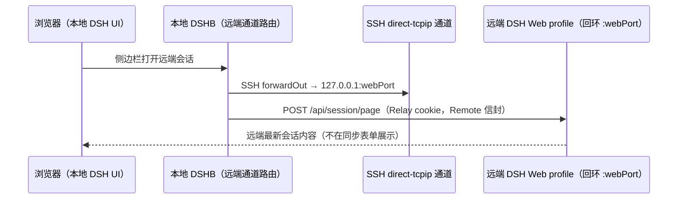
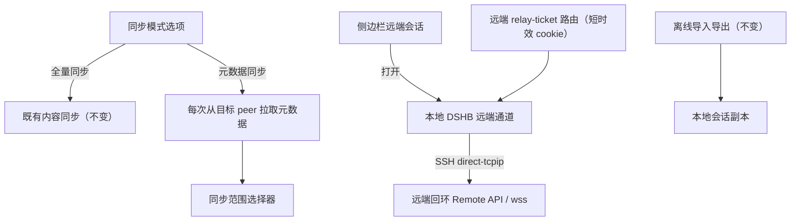

# 技术设计：远端会话中继与双模式同步

Feature Name: 2026-11-03-remote-session-relay
Updated: 2026-11-03

## Description

同步节点新增「同步模式」选项：**全量同步**（既有文件传输方案，行为不变）与**元数据同步**（只同步节点配置与目录；侧边栏会话页通过 SSH + wss 通道实时操作远端 DSH）。元数据同步复用目录 API（`sync-selection-catalog-v1`）从目标 peer 实时拉取元数据；同步范围选择器承载节点/工作区/会话选取，不提供独立的远端目录浏览面板。远端会话通道由本地 DSHB 的 `/api/dshb/sync/relay/<peerId>/` 路由经 SSH direct-tcpip 转发 DSH Remote 协议调用，认证由远端 DSHB 铸造的短时效签名 cookie 完成。离线导入导出不变。

## Architecture





## Components and Interfaces

| 组件 | 位置 | 责任 |
|---|---|---|
| 同步模式选项 | `sync-peer-form.ts`、`sync-peers.tsx` | 勾选「同步工作区会话」后显示模式选择器与说明；取消勾选则隐藏选择器并复位为全量模式 |
| SyncPeer.mode | `src/core/sync/model.ts` | `'full' \| 'metadata'`；缺省 `full`（旧数据兼容） |
| 元数据协调分支 | `src/core/sync/coordinator.ts` | mode=metadata：每次同步实时拉目录、进度报目录计数、跳过会话内容交换；节点配置照常交换 |
| SyncSelectionPicker | `src/client/sync-selection-picker.tsx` | 同步范围选择；每次读取目标 peer 目录，会话显示标题（缺省“未命名会话”，完整 ID 放在提示中），大小显示在名称之后 |
| RelayTicketRoutes | `src/core/sync/relay-auth.ts` | 远端 loopback-only `POST /api/dshb/sync/internal/relay-ticket`：读本机 credentials `client-connection/browser-session` 密钥铸造 ≤10 分钟 cookie |
| RemoteRelayService | `src/core/sync/remote-relay.ts` | 本地远端通道：凭据缓存、`POST /call/<namespace>/<method>` 信封转发（SSH direct-tcpip） |
| SshTransport 扩展 | `src/core/sync/ssh-transport.ts` | `connectClient` 提取复用；`openDirectChannel`（forwardOut）；`fetchRelayTicket` |

### 数据模型

```ts
interface SyncPeer {
  // …既有字段…
  /** 全量同步传输会话内容；元数据同步只同步目录。 */
  mode: 'full' | 'metadata'
}
```

远端目录不写入 `SyncState`；同步范围读取与 metadata 同步执行均实时拉取。远端最新内容属于侧边栏会话页，目录选择器只负责选择同步范围。

### 元数据协调分支（关键语义）

- 节点 manifest 交换与全量模式完全一致（方向、LWW、墓碑）。
- `mode === 'metadata' && syncSessions`：要求对端具备 `sync-selection-catalog-v1` capability（否则 `metadata-catalog-unavailable`）；每次同步实时拉取目录；`fetchSessionManifest/fetchSessionEntries/applySessionBundle` 全部不调用；进度 `lastResult` 附 `catalogNodes/catalogWorkspaces/catalogSessions`。`syncSessions` 关闭时不拉目录且模式复位为 `full`。
- `selection`（自选范围）仍只作用于全量模式。

### 远端会话通道

- 认证：远端 DSHB 与 Host 同进程同 DSH_HOME，用官方 credentials API 读 `credentialKey('client-connection', 'browser-session')`（`{version:1, secret: base64url 32B}`），按 browser-auth 格式铸造 `dsh-auth-<sha256(authority)>` 短时效 cookie；运行时校验记录与 secret 格式，缺失报 `relay-secret-unavailable`。
- 转发：`http.request({ createConnection: () => sshStream })` 直连远端回环端口；请求头重写 `Host: 127.0.0.1:<webPort>`、注入中继 cookie、去除本地认证头；响应信封按远端状态码透传（64MB 上限）。
- 凭据缓存：按对端与 authority 失效，到期前 60 秒重铸；仅存内存。
- wss 流透传：本地 `webServer.registerUpgrade`（per-peer 懒注册 `/api/dshb/sync/relay/<peerId>/app/api/remote.mux`），handler 构造原始升级请求（`Host` 改写、注入中继 cookie、透传 `Sec-WebSocket-*`），等远端 101 后进入双向原始字节管道；`piping` 状态标志防止头部边界后的重复解析。
- 远端会话页反向代理：`GET /api/dshb/sync/relay/<peerId>/app/...` 流式转发远端 Web 前端与 API（剥离 `/app` 前缀、注入中继 cookie、剥离 hop-by-hop/set-cookie/CSP/X-Frame-Options 头、剥离浏览器 fetch 元数据头），响应完成即回收 SSH 通道。远端官方 SPA 无 URL 路由、资源引用为文档相对路径，故其全部请求（unary API、`/api/remote.mux` 升级、静态资源）自然落在此前缀下。
- 会话来源查询：`GET /api/dshb/sync/session-origin?sessionId=` 按同步记录（`localEntityId` → 记录键 → 导入批次 `peerId`）返回 `{peerId, remoteSessionId}`；客户端在侧栏会话行悬停按钮（`sidebar.workspaces.session.row.action` 槽位）显示「打开远端会话」，全屏 iframe 加载远端完整官方 UI（实时事件、发送消息与审批由远端会话页承载）。

## Correctness Properties

1. 中继凭据仅由远端回环内部路由铸造，≤10 分钟有效，任何日志/状态/磁盘均无凭据内容。
2. 远端通道每次传输都发生在已通过 host-key 校验的 SSH 连接上；远端地址固定为 peer 的 `127.0.0.1:remoteWebPort`。
3. 元数据同步 SHALL NOT 写入任何会话事件、附件、spill 对象或本地会话文件；目录只含摘要。
4. 全量同步与离线导入导出的全部既有测试保持通过。
5. 无 mode 字段的旧 peer 数据按全量同步处理，行为与升级前一致。

## Error Handling

| 故障 | 表现 |
|---|---|
| 对端缺目录 capability | `metadata-catalog-unavailable`，提示升级 |
| 远端未运行/端口不通 | ssh-* 分类错误，目录保留 |
| 远端密钥记录缺失 | `relay-secret-unavailable`，提示先启动一次远端 Web profile |
| 中继凭据过期 | 自动重铸一次；仍失败展示认证错误 |
| 信封失败 | 按远端 `result.error.message` 透传展示 |

## Test Strategy

1. 单元：mode 解析与旧数据缺省（`sync-foundation`）；协调器元数据分支（实时拉目录、跳过会话交换、capability 缺失错误码、进度计数）（`sync-coordinator`）；relay-ticket 铸造格式/回环门禁/速率限制（`sync-relay-auth`）；远端通道信封转发/凭据缓存/失败分类（`sync-remote-relay`）；表单 mode 往返（`sync-peer-form`）。
2. 回归：全量同步路径与离线归档既有测试全部通过。
3. 集成（后续）：A/B 双实例实测目录实时拉取、侧边栏远端会话页与 wss 流透传。

## References

- `node_modules/@deepseek-ai/dsh-client-connection`（browser-auth cookie 格式、`/connect`、API 信封）
- `node_modules/@deepseek-ai/dsh-api-session-controller/lib/typert.remote-client.d.ts`（`session/list|page|prompt|follow` 端点）
- `node_modules/@deepseek-ai/dsh-host-webserver/lib/types/index.d.ts`（`registerUpgrade`）
- `.monkeycode/specs/2026-10-21-cloud-sync/`（目录、自选范围与离线归档既有设计）
